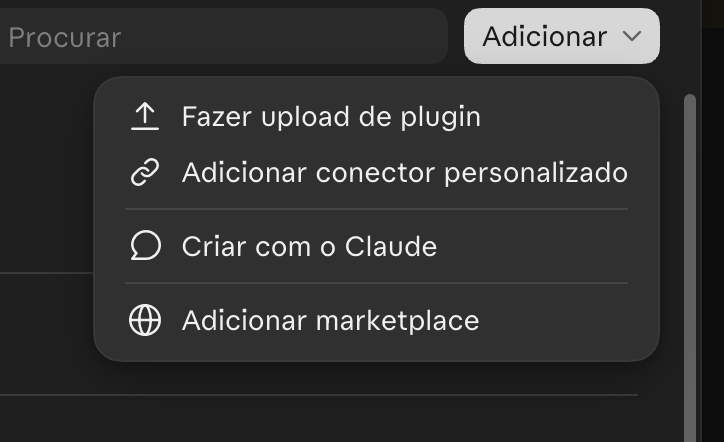
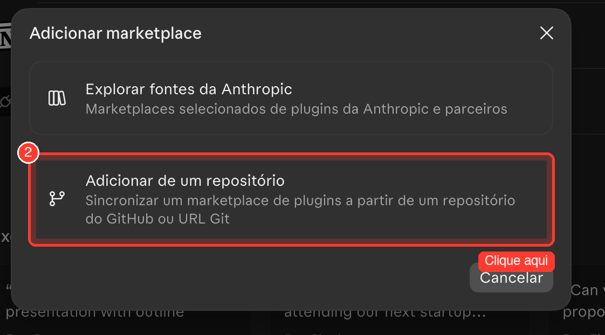
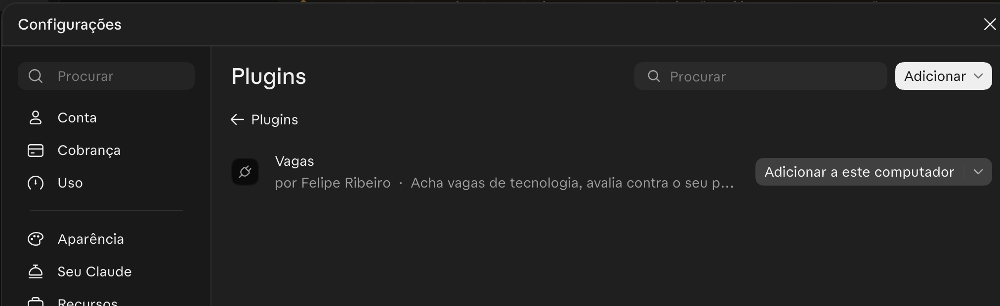
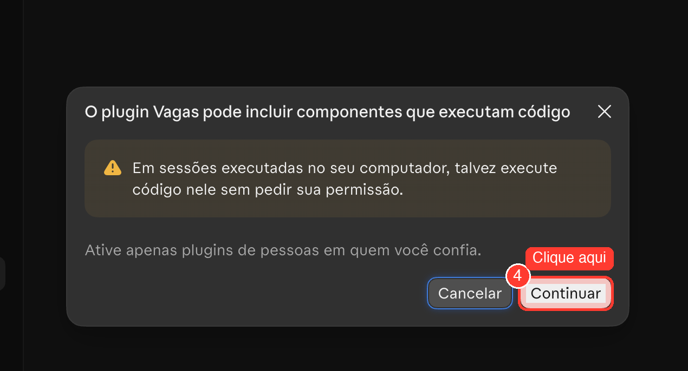

# Kit de Vagas para Tecnologia

Acha vagas de tecnologia, avalia cada uma contra o seu perfil e monta o currículo sob medida. Roda no seu Claude Code, em português, e **nunca envia nada por você**.

Feito por Felipe Ribeiro, designer de produto e fundador do [Decision Brief](https://decision-brief.com), um produto que registra uma decisão por documento: a posição antes da evidência, de onde vem cada dado, o que falta, quem responde e quando revisar. Dá para usar também nas decisões pessoais difíceis, como escolher entre duas ofertas. O kit é independente e gratuito, e a lista de vagas traz um bloco com essa apresentação.

> **Atenção: use o Claude Code, não o chat.** No app do Claude, é a aba **Code**. Ou o terminal. No chat comum o kit não funciona.

## O que ele faz

1. **Pergunta se você já tem um currículo.** É opcional. Se tiver, ele lê o arquivo, entende o que você procura (área, nível, tecnologias) e a busca já sai do seu tamanho. Se não tiver, você só escolhe a área.
2. **Mostra as vagas numa página no navegador**, com 5 vagas: nota, há quantos dias foi publicada (com aviso quando passa de 60 dias) e o botão **Abrir vaga**, que leva direto à página da empresa. Quem procura é um programa comum, sem IA.
3. **Você decide sozinha, ou pede uma comparação.** Na comparação, a IA lê cada vaga contra o seu currículo e diz qual combina mais, o que falta e se vale aplicar.
4. **Monta o currículo e uma carta curta** para a vaga que você escolher. Se faltar informação (um número, o link do seu GitHub ou portfólio), ele pergunta. Os PDFs saem em 3 visuais para você comparar.
5. **Você revisa e envia**, no site da empresa. O kit só guarda o status das suas candidaturas e avisa quando uma ficar parada.

## A regra que não muda

Só entra no currículo o que **você confirmou**. Antes de montar o PDF, o kit mostra todos os fatos que leu do seu currículo numa tela só, e você responde "Todos certos", "Corrigir um" ou "Mais tarde". Um número que não está num fato confirmado trava a geração do pacote. Se você não souber medir um resultado, ele fica sem número: o kit nunca inventa.

## O currículo

PDF de coluna única, texto de verdade, fontes comuns, sem foto, ícones, CPF nem endereço. É o formato que os guias de triagem automática e o checklist da própria Gupy recomendam. Os 3 visuais (Clássico, Moderno e Compacto) só mudam a tipografia e o espaço. O Moderno abre sozinho.

## Em quais computadores funciona

Testado no **Mac**. Em Windows e Linux deve funcionar (o kit usa só o Node.js e abre a lista no navegador padrão), mas ainda não foi testado. A lista de vagas é uma página comum e abre em qualquer navegador.

**O jeito mais seguro de dar o currículo, em qualquer computador:** abra o seu PDF, copie todo o texto e cole na conversa. Passar o caminho de um PDF só funciona sem instalar nada no Mac. Em outros sistemas, o kit pede para você colar o texto. Se você usa Windows ou Linux e algo falhar, abra uma issue neste repositório.

## Requisitos

- Claude Code 2.1.328 ou mais novo
- Node.js 18 ou mais novo (o kit usa só o que já vem nele, não instala nada)
- Google Chrome, Chromium ou Edge para gerar o PDF. Sem eles, o kit entrega o currículo em HTML para você salvar como PDF pelo navegador

## Instalar

**No app do Claude (aba Code):**

1. Abra **Configurações > Plugins**, clique em **Adicionar** e escolha **Adicionar marketplace**.

   

2. Escolha **Adicionar de um repositório** e cole `Decision-Brief/kit-de-vagas`.

   

3. O plugin **Vagas** aparece na lista. Clique em **Adicionar a este computador**.

   

4. O app avisa que o plugin executa código no seu computador. Esse aviso aparece para qualquer plugin com scripts. Se você confia no autor, clique em **Continuar**.

   

5. Vá para a aba **Code**, escolha uma pasta, clique em **Confiar no espaço de trabalho** e digite `/vagas:inicio`.

**No terminal (Claude Code):** cole **um comando de cada vez**, esperando cada um terminar:

```
/plugin marketplace add Decision-Brief/kit-de-vagas
```

```
/plugin install vagas@kit-de-vagas
```

```
/vagas:inicio
```

A primeira execução leva uns 10 minutos (montar o perfil). Depois, `/vagas:inicio` abre um menu com 4 opções.

## Onde ficam os seus dados

Tudo fica numa pasta no seu computador: `~/kit-de-vagas` (perfil, vagas lidas, a página `vagas-de-hoje.html`, pacotes, respostas de opinião). Para usar outra pasta, defina `KIT_VAGAS_HOME`. O kit **não guarda nada fora do seu computador** e o Decision Brief não recebe o seu currículo, as vagas nem o seu nome.

## Para onde o kit faz pedidos de rede

Só para ler páginas públicas de vagas: `boards-api.greenhouse.io`, `api.lever.co`, `api.eu.lever.co`, `api.ashbyhq.com`, `apply.workable.com`, `remotive.com`, `remoteok.com`, `weworkremotely.com` e `portal.gupy.io`. A lista também está declarada em `.claude-plugin/plugin.json`.

## Sobre a Gupy

A Gupy vem **ligada**, porque é onde está a maior parte das vagas do Brasil. Ela não tem uma API pública documentada para candidatos: o kit lê a rota que o próprio site dela usa, que pode mudar sem aviso. Os Termos de Uso do candidato da Gupy restringem a cópia automatizada de vagas. Você decide se quer usar. Para desligar: peça no menu "Ver ou ajustar meu perfil", ou rode `node scripts/kit.mjs config-set gupy nao` na pasta do kit.

## O que o kit não faz

- Não envia candidatura, e-mail nem mensagem.
- Não usa o LinkedIn e não entra em nenhuma conta sua.
- Não inventa experiência, número ou empresa.
- Não vê todas as vagas do mercado: só as das empresas da lista e das fontes acima. Você pode acrescentar uma empresa colando o link da página de vagas dela.

## Como ele evita que a IA improvise

Cada tela sai de um programa, não da IA, e a lista de vagas é uma página gerada pelo programa, então o link de cada vaga aparece sempre. A IA só apresenta o texto e faz a pergunta com as opções que o programa deu. A leitura de cada vaga roda num subagente que não tem permissão para usar nenhuma ferramenta, porque o texto de uma vaga vem de terceiros e pode conter instruções escondidas. A resposta dele é aceita só num formato fixo, com tamanho limitado e sem links.

Isso reduz o desvio, mas não o elimina: uma instrução em texto é um pedido, não uma garantia. As garantias fortes são as do programa.

## Opinião

Depois que você envia uma candidatura, o kit faz uma pergunta curta ("O currículo ficou fiel ao que você viveu?"), sempre com a opção de pular. As respostas ficam **só no seu computador** (`feedback.jsonl`). Nada é enviado.

## Termos de uso

Resumo: uso pessoal e não comercial, sem garantia de resultado, **você revisa e envia cada candidatura**, e os seus dados ficam no seu computador. Leia os [termos completos](TERMOS.md).

## Licença

[PolyForm Noncommercial 1.0.0](LICENSE). Uso pessoal e não comercial é livre. Revender o kit ou usá-lo como parte de um produto comercial exige licença à parte: fale com `contato@decision-brief.com`. Mantenha o aviso de autoria.
